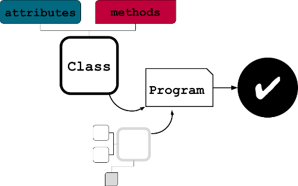

(objects)=
# Python Fundamentals

This section provides a brief introduction to the core concepts of Python. It is
intended to be a self-contained reference for the rest of the training material.

At the core, Python is an **object-oriented** programming (OOP) language.
In short, a computer program is made up of many object variables that hold
**attributes** and **methods** specific to itself. Think of it as a small machine that takes inputs,
store values and does operations on request.

Objects can interact with each other to form a program. Almost all computer programs can be broken down into objects that
are stringed together to perform complex tasks. This kind modular framework allows concise code that is
easy to read and share with others - which explains the popularity of Python in the world of open-source.

The following sections provide a brief introduction to the core objects of Python.

- [Numerics and Strings](0-core.ipynb)
- [Collections](1-collections.ipynb)
- [Functions](2-functions.ipynb)
- [Classes](3-classes.ipynb)
- [Modules](4-modules.ipynb)
